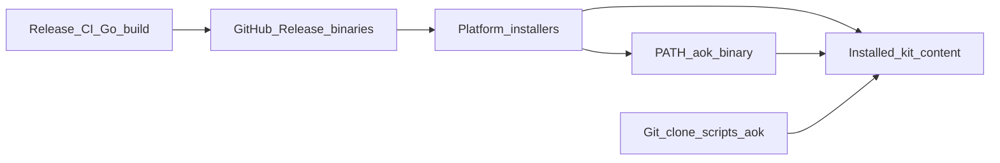

# CLI Distribution

Canonical guide for how Agent Operating Kit ships the `aok` CLI: the thin Go
release binary for end users, and the Python `scripts/aok` entrypoint for
contributors.

This document describes the **intended** distribution model. Binary build and
publish plumbing will match these names and install outcomes when implemented;
until then, release installers and developer checkouts continue to use the
Python kit CLI.

## Two Entrypoints

| Entrypoint | Audience | Runtime on the device |
|---|---|---|
| Release Go binary (`aok` / `aok.exe`) | End users via GitHub Releases and platform installers | Neither Python nor a Go toolchain |
| Python `scripts/aok` | Contributors and kit authors with a git checkout | Python 3 (stdlib only) |

- **Release path:** installers place a platform binary on `PATH` and install kit
  content under the usual roots. Users run `aok` without cloning the repo.
- **Developer path:** clone the repository and run `./scripts/aok` for validate,
  render, install helpers, and any commands not yet on the binary.

## User Runtime Guarantee

For the **release binary** install path:

- No Python runtime is required on the device.
- No Go toolchain is required on the device.
- Go is used only in maintainer CI (and optionally by contributors building
  locally) to produce the binary.

Python remains required only for git-checkout / contributor workflows that call
`./scripts/aok` directly.

## Artifact Naming Convention

Published release names (intended; match release plumbing when implemented):

| Artifact | Role |
|---|---|
| `aok-<version>-darwin-arm64` | macOS Apple Silicon binary |
| `aok-<version>-darwin-amd64` | macOS Intel binary |
| `aok-<version>-linux-amd64` | Linux amd64 binary |
| `aok-<version>-linux-arm64` | Linux arm64 binary |
| `aok-<version>-windows-amd64.exe` | Windows amd64 binary |
| `aok` / `aok.exe` | Installer-bundled entrypoint names on `PATH` |

`<version>` matches the kit version in `.codex-plugin/plugin.json` (see
[VERSIONING.md](../VERSIONING.md)).

Checksums and an artifact index ship alongside installers:

- `SHA256SUMS` — digests for binaries and installers
- `index.json` — lists published artifacts, including binaries

## Install Outcomes

Release installers keep the same kit install roots:

| Platform | Install root |
|---|---|
| macOS | `~/Library/Application Support/Agent Operating Kit/agent-operating-kit` |
| Windows | `%LOCALAPPDATA%\Agent Operating Kit\agent-operating-kit` |
| Linux user | `${XDG_DATA_HOME:-$HOME/.local/share}/agent-operating-kit/agent-operating-kit` |
| Linux system | `/opt/agent-operating-kit/agent-operating-kit` |

`PATH` outcomes for the release path:

- Unix: `~/.local/bin/aok` is the **Go binary** (or a thin shim that invokes it),
  not a symlink to `scripts/aok`.
- Windows: `~/.local/bin/aok.cmd` launches the installed `aok.exe`, not the
  Python kit script.

Plugin marketplace registration and install roots are unchanged. See
[install-and-onboarding.md](install-and-onboarding.md).

## Build And Publish (Maintainers)

Go runs in **CI only** for release builds (contributors may also build locally;
see [CONTRIBUTING.md](../CONTRIBUTING.md)).

Intended release matrix:

| OS | Arch | Published name |
|---|---|---|
| darwin | arm64 | `aok-<version>-darwin-arm64` |
| darwin | amd64 | `aok-<version>-darwin-amd64` |
| linux | amd64 | `aok-<version>-linux-amd64` |
| linux | arm64 | `aok-<version>-linux-arm64` |
| windows | amd64 | `aok-<version>-windows-amd64.exe` |

Maintainer checklist (alongside existing kit validation):

1. Build and test the Go CLI across the platform matrix in CI.
2. Attach binaries to the GitHub Release with the names above.
3. Bundle `aok` / `aok.exe` into platform installers so `PATH` installs the
   binary.
4. Update `SHA256SUMS` and ensure `index.json` lists every binary artifact.
5. Keep Python `./scripts/aok validate` and `python3 -m py_compile` for kit
   sources (content and packaging still use Python in-repo).

Full steps: [release-checklist.md](release-checklist.md).

## Command Parity

Parity is tracked until the binary covers the core user surface. For first-ship
docs, mark core user commands as **intended on the binary**; developer-only
commands may stay on Python `scripts/aok`.

| Command / area | Release binary (intended) | Python `scripts/aok` |
|---|---|---|
| `install` / installer-driven setup | Yes | Yes (checkout / helpers) |
| `doctor` | Yes | Yes |
| `validate` | Yes | Yes |
| `version` | Yes | Yes |
| `render` (pack / all / bundles) | Yes | Yes |
| `codex setup` / Codex helpers | Yes (core setup) | Yes (full surface) |
| `claude setup` | Yes | Yes |
| Project init / local-env extras | Tracked for parity | Yes |
| Release packaging (`scripts/release`) | No (maintainer) | Yes (Python) |
| Other developer-only helpers | May stay Python | Yes |

Until parity is complete, contributors should prefer `./scripts/aok` for any
command the binary does not yet expose. End-user docs assume the binary path for
install, doctor, validate, version, render, and Codex/Claude setup.

## Uninstall

Two separable pieces:

1. **Binary + shim** — remove the PATH entry (`~/.local/bin/aok` or
   `~/.local/bin/aok.cmd` / `aok.exe`). This is a binary (or shim to a binary),
   not a symlink to `scripts/aok`.
2. **Kit tree** — remove the install root and marketplace/plugin registration as
   described in [uninstall-and-rollback.md](uninstall-and-rollback.md).

Removing only the binary leaves kit content on disk; removing only the kit tree
leaves a broken `PATH` entry until the shim is deleted.

## Distribution Flow

## Related Docs

- [install-and-onboarding.md](install-and-onboarding.md)
- [uninstall-and-rollback.md](uninstall-and-rollback.md)
- [release-checklist.md](release-checklist.md)
- [architecture.md](architecture.md)
- [ROADMAP.md](../ROADMAP.md)
