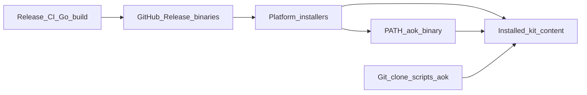

# CLI Distribution

Canonical guide for how Agent Operating Kit ships the `aok` CLI: the thin Go
release binary for end users, and the Python `scripts/aok` entrypoint for
contributors.

This document describes the **implemented** distribution model. Release CI
cross-compiles platform binaries, lists them in `SHA256SUMS` / `index.json`, and
bundles `bin/aok` into installers that invoke the binary for `install` /
`doctor` without Python on the end-user path.

## Two Entrypoints

| Entrypoint | Audience | Runtime on the device |
|---|---|---|
| Release Go binary (`aok` / `aok.exe`) | End users via GitHub Releases and platform installers | Neither Python nor a Go toolchain |
| Python `scripts/aok` | Contributors and kit authors with a git checkout | Python 3 (stdlib only) |

- **Release path:** installers place a platform binary on `PATH` and install kit
  content under the usual roots. Users run `aok` without cloning the repo.
- **Developer path:** clone the repository and run `./scripts/aok` for validate,
  render, install helpers, and any commands not yet on the binary (or prefer
  Python while authoring kit content).

## User Runtime Guarantee

For the **release binary** install path:

- No Python runtime is required on the device.
- No Go toolchain is required on the device.
- Go is used only in maintainer CI (and optionally by contributors building
  locally) to produce the binary.

Python remains required only for git-checkout / contributor workflows that call
`./scripts/aok` directly. Maintainer release packaging uses the Go tool
`cmd/aok-release` (via `scripts/release/build.sh`), which invokes Go
`aok render bundles` for the bundles artifact.

## Artifact Naming Convention

Published release names (match `cmd/aok-release` / `scripts/release/build.sh`):

| Artifact | Role |
|---|---|
| `aok-<version>-darwin-arm64` | macOS Apple Silicon binary |
| `aok-<version>-darwin-amd64` | macOS Intel binary |
| `aok-<version>-linux-amd64` | Linux amd64 binary |
| `aok-<version>-linux-arm64` | Linux arm64 binary |
| `aok-<version>-windows-amd64.exe` | Windows amd64 binary |
| `aok` / `aok.exe` | Installer-bundled entrypoint names on `PATH` |

`<version>` matches the kit version in `.codex-plugin/plugin.json` (see
[VERSIONING.md](../VERSIONING.md)).

Checksums and an artifact index ship alongside installers:

- `SHA256SUMS` — digests for binaries and installers
- `index.json` — lists published artifacts, including binaries

## Install Outcomes

Release installers keep the same kit install roots:

| Platform | Install root |
|---|---|
| macOS | `~/Library/Application Support/Agent Operating Kit/agent-operating-kit` |
| Windows | `%LOCALAPPDATA%\Agent Operating Kit\agent-operating-kit` |
| Linux user | `${XDG_DATA_HOME:-$HOME/.local/share}/agent-operating-kit/agent-operating-kit` |
| Linux system | `/opt/agent-operating-kit/agent-operating-kit` |

`PATH` outcomes for the release path:

- Unix: `~/.local/bin/aok` is the **Go binary** (file copy), not a symlink to
  `scripts/aok`.
- Windows: `~/.local/bin/aok.cmd` launches the installed `aok.exe`, not the
  Python kit script.

Plugin marketplace registration and install roots are unchanged. See
[install-and-onboarding.md](install-and-onboarding.md).

## Build And Publish (Maintainers)

Go runs in **CI only** for release builds (contributors may also build locally;
see [CONTRIBUTING.md](../CONTRIBUTING.md)).

Release matrix:

| OS | Arch | Published name |
|---|---|---|
| darwin | arm64 | `aok-<version>-darwin-arm64` |
| darwin | amd64 | `aok-<version>-darwin-amd64` |
| linux | amd64 | `aok-<version>-linux-amd64` |
| linux | arm64 | `aok-<version>-linux-arm64` |
| windows | amd64 | `aok-<version>-windows-amd64.exe` |

Maintainer checklist (alongside existing kit validation):

1. Build and test the Go CLI across the platform matrix in CI.
2. Attach binaries to the GitHub Release with the names above.
3. Bundle `aok` / `aok.exe` into platform installers so `PATH` installs the
   binary.
4. Update `SHA256SUMS` and ensure `index.json` lists every binary artifact.
5. Keep Python `./scripts/aok validate` and `python3 -m py_compile` for kit
   content sources. Release packaging is Go (`go run ./cmd/aok-release`).

Full steps: [release-checklist.md](release-checklist.md).

## Command Parity

| Command / area | Release binary | Python `scripts/aok` |
|---|---|---|
| `install` / installer-driven setup | Yes (implemented) | Yes (checkout / helpers) |
| `doctor` | Yes (implemented) | Yes |
| `validate` | Yes (implemented) | Yes |
| `version` | Yes (implemented) | Yes |
| `render` (`pack` / `all` / `bundle` / `bundles`) | Yes (implemented) | Yes (also used by release packaging) |
| `codex setup` / `codex local-env` | Yes (implemented) | Yes |
| `claude setup` | Yes (implemented) | Yes |
| `project init` / `project validate` | Yes (implemented) | Yes |
| `methodology` / `work-item` / `work-system` | Not yet implemented | Yes (contributor commands) |
| Release packaging (`scripts/release` / `cmd/aok-release`) | No (maintainer Go tool) | N/A (Python `build.py` removed) |
| `task sync` / `task packet` | Yes (implemented; requires `gh` on `PATH`) | Yes |
| `hooks pre` / `hooks after` | Yes (implemented) | Yes |
| `import history` | Yes (implemented) | Yes |

`task` / `hooks` / `import` are available on both entrypoints. Python
`./scripts/aok` remains for kit authorship and checkout workflows without a Go
build. End-user docs assume the binary path for install, doctor, validate,
version, render, Codex/Claude setup, and these contributor helpers when the
release binary is installed.

Methodology selection/scaffolding, work-item export, and work-system discovery
currently use `./scripts/aok` from a checkout or extracted kit with Python
available. Their catalogs are included in release archives; binary command
parity for these three groups is separate follow-up work.

## Trust model (unsigned releases)

Published GitHub Release binaries are **unsigned by default**. Code signing is
optional and secrets-gated (`scripts/release/sign.sh`); when secrets or tools
are absent the script skips and exits 0 so the release still publishes.

- Verify downloads against the Release `SHA256SUMS` file.
- macOS Gatekeeper, Windows SmartScreen, or similar may warn once on first run;
  that is expected without Apple/Windows signing certificates.

## Install via package managers

Package managers consume GitHub Release binaries (same artifact names as above).
Templates live under [`packaging/`](../packaging/); the regenerator also writes
**same-repo published paths** so users install without a separate tap/bucket:

| Channel | Same-repo path | How to install |
|---|---|---|
| Scoop | `bucket/aok.json` | `scoop bucket add aok https://github.com/ArmanAvanesyan/agent-operating-kit` then `scoop install aok` |
| Homebrew | `packaging/homebrew/aok.rb` | `brew install --formula https://raw.githubusercontent.com/ArmanAvanesyan/agent-operating-kit/main/packaging/homebrew/aok.rb` (classic `user/tap` deferred) |
| winget | `packaging/winget/*.yaml` | Keep manifests in-repo; open a PR to `microsoft/winget-pkgs` when ready |

```bash
./scripts/packaging/generate-from-release.sh --version <version>
# or from a local build:
./scripts/packaging/generate-from-release.sh --dist dist/release
```

CI: `.github/workflows/packaging.yml` regenerates on `v*` tags and uploads
`packaging/out/` artifacts. Optional pushes to an external tap/bucket/
winget-pkgs are token-gated (`PACKAGING_PUSH_TOKEN`, optional
`HOMEBREW_TAP_REPO` / `SCOOP_BUCKET_REPO`) and not required for the install
paths above.

### PyPI

**Closed / not planned** for the Go `aok` binary. Native binaries are not Python
packages; use Releases, installers, or Homebrew / Scoop / winget instead.

## Uninstall

Two separable pieces:

1. **Binary + shim** — remove the PATH entry (`~/.local/bin/aok` or
   `~/.local/bin/aok.cmd` / `aok.exe`). This is a binary (or shim to a binary),
   not a symlink to `scripts/aok`.
2. **Kit tree** — remove the install root and marketplace/plugin registration as
   described in [uninstall-and-rollback.md](uninstall-and-rollback.md).

Removing only the binary leaves kit content on disk; removing only the kit tree
leaves a broken `PATH` entry until the shim is deleted.

## Distribution Flow



## Related Docs

- [install-and-onboarding.md](install-and-onboarding.md)
- [uninstall-and-rollback.md](uninstall-and-rollback.md)
- [release-checklist.md](release-checklist.md)
- [architecture.md](architecture.md)
- [ROADMAP.md](../ROADMAP.md)

## Static foundations commands

The built Go binary embeds operational schemas and native parsers. Agent validation,
resolution, planning/decision checks, and the eight native agent adapters run without
Python or runtime schema downloads. The contributor Python entrypoint does not
expose these commands. See [operator instructions and native gate limits](native-adapter-operations.md).
CI builds with Go 1.22, cross-compiles Linux/macOS/Windows for amd64/arm64, and
runs built-binary validation with an empty PATH. Cross-compilation does not prove
execution on those operating systems. No release is published by these checks.
