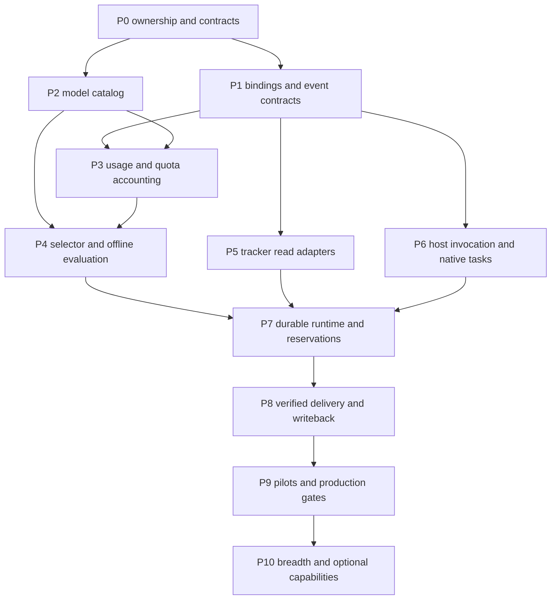

# End-to-end workflows and usage-aware model selection

Status: proposed implementation plan; no new runtime capability is implemented by
this document. Baseline inspected 2026-10-18 at
`9976f52666e1a9c442d04774594e662bcec42bf3`. Delivery order is dependency-based,
not a calendar commitment. All command names and new resource names below are
proposed interfaces until their phase passes acceptance.

## Outcome and scope

Deliver a recoverable path from a GitHub, Azure DevOps, Linear or Jira work item
through a validated AOK assignment, capacity-aware model choice, Claude Code or
Codex execution, independent verification, repository delivery and reconciled
tracker updates. Extend execution and usage collectors to all eight existing
native-adapter targets only as each target passes its own compatibility gate.

Model selection must consider task suitability, observed accepted outcomes,
current account capacity, reset times, cost, deadlines and explicit preferences.
Tracking historical tokens alone does not satisfy this requirement.

First release scope: local operator, one runtime authority, GitHub, Codex,
provider-reported quota where available, and report-only selection before automatic
dispatch. Next add Claude, Azure, Linear and Jira Cloud. Jira Data Center is a
separate adapter/version gate. Do not promise every host/provider cross-product
until exercised. No account rotation to bypass service limits.

## Existing capabilities to reuse

| Area | Implemented baseline | Gap addressed here |
|---|---|---|
| Agent contracts | Strict embedded schemas, pinned references, resolution and permission intersection | Verified executable handoff and enforcement evidence |
| Planning | DAG eligibility, evidence freshness, revisions, decision-result validation | Observed execution, evidence production and bounded continuation |
| Native adapters | Eight static projections with bounded loading evidence | Invocation and per-control runtime conformance |
| GitHub | Issue/PR reads and packet generation through Go/Python task commands | Durable identity binding, conflict-safe updates and reconciliation |
| Azure | Read-only work-system discovery, conformance and local binding | Individual work-item ingestion and explicit write capabilities |
| Work items | Local templates, desired-state exports and generated-file protection | Live provider adapters; retain local exports independently |
| Delivery | Embedded preservation, checkpoints, isolated shipping and snapshot evidence | Bind accepted workflow results to existing delivery receipts |
| Model research | Dated Codex/Claude guidance and OpenCode/agy discovery exports | Operational catalog, usage collectors, selector and evaluation |
| Exploration/readiness | Bounded helpers and supplied-record validation | Verified readiness tied to each actual attempt/environment |

See [agent foundations](agent-foundations/README.md),
[planning](../planning-foundations.md), [delivery](../repository-delivery.md),
[research](../research/model-selection.md), and
[earlier workflow roadmap](../research/development-workflows/implementation-plan.md).
This plan refines the remaining work; it does not reclassify implemented static
planning as absent or promote historical proposal schemas into production.

## Ownership and compatibility decisions

| Layer | Responsibility | Boundary |
|---|---|---|
| AOK | Contracts, capability catalog, selection policy, projections, validation and acceptance rules | No durable scheduling daemon or credential store |
| External runtime, initially a pinned swarmd integration | Live claims, attempts, leases, cancellation, reservations, recovery and outbox | Must demonstrate these capabilities; do not assume current APIs provide them |
| Host executor | Launch/attach, native session/task operations, events, outputs, usage observations | Native completion is not AOK acceptance |
| Sandbox | Enforce filesystem/network/process/tool restrictions where supported | Worktrees and instructions are not enforcement |
| Infrastructure | Compute, credentials, network and service availability | Owned outside AOK |
| Tracker | External identity, requirements and configured business fields | No implicit cross-provider mirroring |
| Delivery pack | Preservation, repository operations and delivery evidence | Agent review does not become a submitted human approval |

New end-user integration commands should be Go-first, with optional external host
dependencies discovered explicitly. Preserve current Python task behavior and
document intentional parity limits. Keep work-system setup separate from project
init. Preserve existing task packets; use separately versioned bindings rather
than adding unknown keys to closed schemas. Expand schema envelopes only through
an explicit compatibility ADR and migration tests.

Use supported host/provider APIs, SDKs or bounded documented CLI output. Do not
read private credential databases or undocumented session stores. Explicit manual
quota snapshots are allowed, labeled as manual and expired conservatively.
Provider credentials stay in existing host credential mechanisms; artifacts use
opaque references. Logs and reports must not expose tokens or unrelated messages.

## Dependency graph and release gates



P2 and P1 can proceed independently after P0. P5 provider implementations and P6
host implementations can proceed independently against shared conformance fixtures.
P4 starts with recorded usage fixtures while P3 live collectors mature. Each
vertical path needs only its relevant provider/host gates, not every adapter.

| Milestone | Required gates | User-visible result |
|---|---|---|
| M1 advisory | P0-P4 | Explainable model/capacity report; no execution |
| M2 first vertical path | M1, GitHub P5, Codex P6, P7-P8 | Recoverable GitHub-to-Codex-to-verified-delivery path |
| M3 requested integrations | M2 plus Claude, Azure, Linear, Jira gates and P9 | All requested systems supported within declared scopes |
| M4 broader ecosystem | M3 and target-specific P10 gates | Additional coding CLIs, optional campaigns/provisioning |

## P0 — Reconcile architecture and lock the delivery contract

Dependencies: none. Suggested owner: contracts/architecture maintainers.

- P0-01: record current behavior, command surfaces and evidence in a capability matrix.
- P0-02: ADR for static definitions versus mutable runtime records, runtime selection,
  credential ownership, local data retention and field ownership.
- P0-03: define completion vocabulary: eligible, running, blocked, cancelled,
  exhausted, failed, verification-passed, accepted and delivered.
- P0-04: pin initial host/runtime/API versions and supported auth modes. Resolve
  actual swarmd capability/config names; do not copy stale database examples.
- P0-05: define compatibility/migration for new contracts and Go/Python surfaces.

Acceptance: every capability has an owner and explicit support level; no adapter
claims enforcement from parsing/loading. Existing packets, project init, bindings,
renders and delivery entrypoints remain compatible. Stop-on-unknown and explicit
override semantics are defined before execution work begins.

## P1 — Shared bindings, execution records and connector protocol

Dependencies: P0. Suggested code: new focused packages alongside
`internal/contracts`, `internal/task` and `internal/evidence`.

Proposed resources (names subject to P0 ADR):

| Resource | Minimum contents |
|---|---|
| WorkItemBinding | Provider/tenant/project, immutable remote ID, display key/URL, local packet hash, field map, source revision, mapping version |
| HostTaskBinding | Work-item/plan-step refs, host version, session/thread/task IDs, assignment digest and attempt ID |
| RunRecord | Runtime ID, lease/fence, input revision, selected configuration, policy refs, checkpoints, outputs and final disposition |
| ConnectorCapability | Supported read/write/transition/comment/link operations and concurrency guarantees |
| SyncOperation / Receipt | Logical operation ID, authorization ref, expected remote state, desired delta, dispatch/readback evidence |
| UsageEvent / QuotaSnapshot / Reservation | Typed accounting records detailed below |
| SelectionDecision | Candidates, evidence versions, constraints, rejection reasons, estimates and chosen configuration or abstention |

Connector operations: discover, read, normalize, plan-update, apply-update,
reconcile and capability-report. Reads never implicitly create resources. Writes
consume an authorized operation plan and explicit capability, not imported issue
instructions. The runtime persists mutable records; AOK validates/export reports.

Acceptance: fixture tests reject cross-tenant collisions, dangling references,
unsafe paths, unsupported operations, duplicate event IDs and conflicting bindings.
One external item may bind to multiple attempts; one attempt may not silently
claim another item's completion. Old readers fail clearly on unsupported versions.

## P2 — Convert model research into an operational catalog

Dependencies: P0. Suggested code: `internal/modelcatalog`; embedded definitions
and external signed/trusted-source policy decided in P0 (hashes alone do not imply trust).

- P2-01: importer for all four existing research exports, preserving raw hashes,
  source URLs/dates and official/derived/observed distinctions.
- P2-02: canonical configuration identity:
  `(host, hostVersion, provider, modelID, modelRevision, reasoning, serviceTier,
  authMode, endpoint/deployment, toolProfile)`; keep unknown revision explicit.
- P2-03: capability declarations for context/output limits, modalities, tools,
  structured output, reasoning options and task-class evidence. Distinguish
  declared from observed support; aliases never erase evaluated model identity.
- P2-04: explicit refresh/import/diff with validity intervals, deprecation/removal
  notices and provenance. No hidden network dependency during ordinary validation.
- P2-05: bounded invocation probe using an explicitly authorized test profile;
  catalog listing alone never establishes access or task quality.

Acceptance: all existing snapshots import reproducibly; no benchmark or pricing
claim is strengthened. Unknown models remain usable only under explicit policy,
not assigned invented capability scores. Adapter-supported model/effort mapping
can be checked by the resolver, while enforcement and access remain separate gates.

## P3 — Per-CLI usage collectors and shared capacity accounting

Dependencies: P1 and P2. Suggested code: `internal/usage`, host collector modules;
runtime-owned private event ledger and reservation service.

- P3-01: normalize token/request/currency/credit metrics with source units,
  cached-read/write semantics and whether tokens are cumulative or incremental.
- P3-02: ingest authoritative remaining-limit snapshots, including all simultaneous
  windows and scope identities; separate observed values from estimates.
- P3-03: deduplicate by host/session/turn/request/event and reconcile cumulative
  corrections without double counting. Track parent/child attribution explicitly.
- P3-04: add atomic, fenced capacity reservations and reconcile after runs; support
  lease expiry, crash, cancellation and provider snapshot updates.
- P3-05: expose summary by host, model, account pool, project, work item and run.
  Show freshness, coverage, unknowns and excluded unobserved external usage.
- P3-06: use TTL caching, event-triggered refresh and bounded backoff. Never infer
  unlimited capacity from an unavailable endpoint or repeatedly poll interactive UI.

Initial collector matrix (implementation targets, not current AOK support):

| Host | First collection mechanism | Remaining-capacity strategy | Completion gate |
|---|---|---|---|
| Codex | Versioned App Server usage events and account rate-limit read/updates | Prefer multi-bucket view; subscription/account limits distinct from API budgets | Pinned host fixtures plus live read, event dedupe, missing-field and reset tests |
| Claude Code | Documented structured run output; opt-in status-line input collector composed with existing configuration | Documented rate-limit fields when supplied; gateway/API modes handled separately | Version/auth-mode fixtures, no replaced status line without configured installation, observed quota update |
| OpenCode | Supported versioned session/event/usage interface after discovery spike | Provider adapter where documented; otherwise unknown/manual | Usage source semantics and actual model/provider attribution demonstrated |
| agy | Documented CLI/event surfaces after discovery spike | Official supported signal if available; otherwise unknown/manual | No quota inferred from `agy models`; supported source/version recorded |
| Cursor | Supported CLI run output/usage interface after discovery spike | Official account/admin surface if available and authorized | No dashboard scraping dependency; absent endpoint reported unsupported |
| Gemini CLI | Documented run statistics/events after discovery spike | Supported provider/account quota source; otherwise unknown/manual | Auth-mode-specific token and quota fixtures |
| OpenClaw | Supported session/model usage surface after discovery spike | Underlying provider adapter and explicit account identity | Child calls and routed provider usage reconcile without duplication |
| Hermes Agent | Supported run/session usage surface after discovery spike | Underlying provider adapter; otherwise unknown/manual | Source/version identified and normal launcher behavior exercised |

Discovery spikes produce a verified support matrix, not guessed CLI flags. A host
can ship usage-only support while remaining-quota support stays unsupported.

Acceptance: all eight targets report either supported observations or explicit
unsupported/unknown states. Codex/Claude pass live scoped collectors first. Tests
cover shared accounts across CLIs, duplicate/reordered events, stale snapshots,
multi-window resets, interrupted streams, corrections and concurrent reservations.
No persisted credentials or transcript content in the accounting ledger.

## P4 — Explainable model selection and evaluation MVP

Dependencies: P2; P3 records/fixtures, then live collectors. P1 selection record.

- P4-01: task profile from packet/plan: task class, languages, scope/risk,
  tool/context/output requirements, deadline and minimum quality evidence.
- P4-02: deterministic hard filters, explicit overrides and report-only ranking.
- P4-03: empirical consumption estimates by configuration/task class, with intervals
  and cold-start policy; never convert subscription percentages from token counts.
- P4-04: quota-aware candidate ranking, wait/defer/abstain, hysteresis and allowed
  fallback graph. Persist every decision and its input snapshot references.
- P4-05: benchmark harness and replay simulator using the evaluation protocol below.

Acceptance: identical pinned inputs yield identical decisions. A high scoring
candidate cannot override capabilities, minimum quality, authorization or budget.
Exhausted/stale/unknown quota cases produce the configured disposition and explain
it. Advisory mode cannot launch work, buy credits, switch billing, or update trackers.

## P5 — Tracker adapters: read first, write plans second

Dependencies: P1. Each provider gets its own fixtures and independently versioned
capability matrix; P7/P8 unlock live execution/writeback later.

| Package | Deliverables | Provider-specific acceptance |
|---|---|---|
| P5-GH | Reuse GitHub reads; normalize issues/PRs; project/item/field discovery; delta/comment/link plans | Distinguish issue status from Projects fields; PR merge is separate from issue acceptance; paginate and preserve unmapped fields |
| P5-AZ | Ingest individual work items, relations, revisions, identities and configured fields; map to packets | Preserve actual process work-item/state IDs; revision conflict is detected; system-process customization stays blocked |
| P5-LI | Linear workspace/team discovery, issue ingestion, workflow states, relations and update plans | Bind immutable IDs separately from display identifiers; handle GraphQL partial errors and pagination without false success |
| P5-JI | Jira Cloud project/type/field discovery, issue ingestion, rich-text conversion, links and transition plans | Discover allowed transitions/required fields; never assume status is a free-text update; preserve unsupported rich-text structures with diagnostics |

Common acceptance: sandbox fixture can be read into a valid packet with provenance;
missing required semantics blocks rather than drops data. Identity/permission
failures and rate limits have explicit dispositions. Replay/read does not write.
Manual edits and unsupported relationships survive round trips or block a lossy
operation. Polling checkpoints handle pagination/reordering; future webhooks add
signature verification, dedupe and ordering rules rather than replacing reconciliation.

Each provider write capability must state atomic conditional-update support. Where
the API cannot enforce the supplied precondition, use a conservative field policy,
re-read/readback and report unresolved races; do not claim atomic compare-and-swap.

## P6 — Codex and Claude execution/native task bridges

Dependencies: P1; P2 for model compatibility; P3 for run accounting.

P6-CX (first host): version-pinned Codex App Server client for start/resume,
turn submission/events, interruption, approvals and outputs. Bind AOK assignment
and attempts to thread/turn IDs. Native goals are optional continuation controls;
do not equate a native goal or completed turn with accepted AOK work. Cloud-task
support is a separate transport/capability gate, not implied by local App Server.

P6-CL: supported Claude execution interface and event parsing, session identity,
resume/cancellation and tool availability discovery. Project supported plan steps
into TaskCreate/Get/List/Update only when those tools are exposed. Task tracking,
background processes and subagent execution are distinct capabilities. Without
task tools, explicit session-only execution may be supported; do not emulate a
native list by editing private host files.

Both bridges must preserve AOK's richer QA/review/blocked states outside the
native list when no exact host representation exists. Native task updates are
observations. External business-field changes require a separate authorized
connector operation. Child-agent dispatch is opt-in, not a mandatory workflow.

Acceptance: fixture and authorized live runs demonstrate actual selected model,
instructions, inputs, output validation, cancellation and resumption. Required
controls each have observed enforcement or an identified trusted external owner;
unsupported required controls block. Duplicate completed events and native task
deletion/clearing cannot cause false AOK acceptance. Failed/expired leases cannot
publish results. Cloud Codex invocation is marked unsupported until separately tested.

## P7 — Durable execution and quota reservations

Dependencies: P1, P4, one P5 provider and one P6 host.

- P7-01: pin and probe runtime capabilities; version the lifecycle translation.
- P7-02: wire eligible plan steps to fenced claims, isolated workspace staging,
  selection decisions, atomic local reservations and host attempts.
- P7-03: persist checkpoints, evidence/artifact hashes and bounded retry state.
- P7-04: stop/defer for quota exhaustion, blockers, cancellation, deadline or failed
  invariants; reselect only at safe checkpoints under approved policy.
- P7-05: recover orphaned attempts, lost streams and ambiguous writes via reconciliation.
- P7-06: status/explain/resume/cancel operator operations with audit records.

Acceptance: concurrent schedulers cannot double-claim work or over-reserve known
local capacity; crashed agents preserve patches. An old attempt cannot finalize
after fencing. Blocked is recoverable and is not mapped to terminal failed.
Cancellation stops new dispatch; in-flight stop is observed or explicitly unknown.
No promise of exactly-once external execution: reconcile at-least-once events and
ambiguous effects. Shared external usage can still exhaust a provider quota;
local reservations are conservative coordination, not provider guarantees.

## P8 — Verification, delivery and controlled tracker writeback

Dependencies: P5-P7 for the selected path; existing delivery pack.

- P8-01: run trusted pinned verifiers and store revision/environment-bound results;
  model self-report never satisfies a required verifier.
- P8-02: enforce aggregate goal predicates, inventory coverage and independent
  review where required. Preserve failed/unknown evidence dispositions.
- P8-03: hand accepted artifacts to existing preservation/shipping workflows and
  consume their exact-revision receipts; avoid a second delivery engine.
- P8-04: durable outbox for authorized comments, evidence links, status changes,
  and explicitly requested creation. Use provider idempotency where available;
  otherwise stable markers, readback and ambiguity handling, not blind retries.
- P8-05: reconcile partial updates, external edits and revoke/expire pending plans
  after material requirement or revision changes.

Acceptance per provider: authorized sandbox write/readback; duplicate delivery
event produces no duplicate logical update; crash after remote success is recovered;
conflicting human edit is preserved or surfaced. No Done on failed verification,
missing review or stale source. Merging, deployment and process customization
remain separately scoped capabilities. This document authorizes no live external writes.

## P9 — Pilots, operational readiness and release

Dependencies: P8 for each claimed combination; evaluation gates below.

- First pilot: GitHub + Codex with advisory selection, then controlled dispatch.
- Second pilot: GitHub + Claude with native task availability variants.
- Next pilots: Azure, Linear and Jira, each with at least one proven host.
- Cover focused edit, verified bug repair, multi-step delivery, interrupted run,
  quota exhaustion and tracker-write ambiguity. Extend campaign scale only after recovery.
- Publish exact supported versions/scopes/auth modes, known gaps, upgrade detection,
  data retention, incident recovery and rollback instructions.

Acceptance: end-to-end read/dispatch/verify/deliver/reconcile evidence for every
claimed combination; negative/recovery cases pass; operator can inspect blockers,
cancel and resume. Package checks exercise Go binaries without Python except the
documented optional delivery helpers. No blanket cross-platform certification.

## P10 — Broader hosts and remaining optional capabilities

Dependencies: relevant P3/P6/P9 gates, not merely static adapter registration.

Add OpenCode, agy, Cursor, Gemini, OpenClaw and Hermes execution one host at a time,
reusing usage and native conformance. Extend Codex Cloud and Jira Data Center
independently. Add evidence-backed campaign planners, outcome evaluators and
governed optimization only after fixed-DAG execution is reliable.

Keep other backlog separate: selectable FDD/DSDM/AUP require lifecycle enforcement;
AM needs operational content; remote GitHub/Azure provisioning needs explicit
plans, safe provider-specific apply/recovery and inherited-process restrictions;
methodology/work-item/work-system Go parity needs distribution tests. These are
not prerequisites for the first end-to-end workflow. Windows delivery preservation
requires its own certification. No automatic credit purchase, quota reset redemption
or switch to paid API billing is introduced by model selection.

## Usage and quota mechanism

### Separate four kinds of measurement

1. Observed consumption: tokens, cache categories, requests, duration and provider
   cost, tagged with actual configuration and account pool.
2. Calculated expense: price-table estimate with currency, effective date and
   uncertainty; subscription token-equivalent cost is not an invoice.
3. Provider-reported remaining capacity: account/model/shared windows, credits,
   spend limits and reset times; this is the basis for known hard eligibility.
4. Local reservations/predictions: conservative estimates for planned work, never
   relabeled as provider facts.

Event fields: unique event ID, run/attempt/step refs, host/session/request IDs,
actual model/provider/effort, pseudonymous account pool, auth mode, metric/unit,
delta-or-cumulative semantics, source timestamp, observed timestamp, provenance,
confidence category and correction relation. Unknown costs/tokens remain null.

Quota fields: source/version, pool and applicable model/host set, window/metric,
used/remaining/limit where known, reset semantics/time, observedAt/expiresAt,
precision, authority category and optional provider block/retry time. Missing is
not zero; missing is not unlimited. RPM/TPM, subscription windows, credits,
project spend caps and context-window capacity are distinct dimensions.

### Aggregation without false capacity

Summaries group by host/model/project, but deduplicate underlying events first.
Do not sum cumulative snapshots. Add currency only within the same currency and
valuation basis; preserve provider-reported and estimated totals separately.
Do not count a shared provider call again in both parent and child rollups.

Maintain a pool graph: configurations point to every applicable account/provider/
model/project constraint. Two CLIs using the same account share the same pool;
several models may also share a pool. For applicable overlapping windows, each
window constrains dispatch independently; percentages cannot be added across
accounts or converted into a global percentage remaining.

The dashboard can show compatible absolute totals and separate quota bars, plus
capacity by eligible route. It must never display “150% quota remaining” by adding
two unrelated allowances. Context remaining is a per-session input constraint,
not an account quota.

### Conservative reservation math

For candidate c and each applicable constraint w:

```text
available(c,w) = provider_remaining(w)
                 - local_uncovered_reservations(w)
                 - external_usage_uncertainty_margin(w)
                 - policy_reserve(w)

dispatchable(c) requires predicted_upper_consumption(c,w) <= available(c,w)
                       for every required known constraint w
```

“Uncovered” means reservations not already included in the provider observation.
Use request watermarks/provider event identity when available; otherwise retain
conservative uncertainty rather than double counting with invented precision.
Use integer/fixed-point values with units, not incompatible sums. Percent-only
quotas permit percentage-point estimates only with calibrated observations; they
do not reveal absolute token allowance. If consumption cannot be estimated,
select a bounded canary or defer according to policy, not a fabricated fit.

Reserve estimate and margin atomically before dispatch, validate TTL/lease at
launch, settle actual observed usage afterward, then refresh authoritative data.
Do not release uncertain in-flight consumption just because a worker disappeared.
An account observed depleted stays blocked until refresh/reset observation; time
passing alone need not mean a fixed reset for rolling-window providers.

## Selection algorithm and operator controls

Stage 1: filter candidates by explicit host/model pin, permissions, auth/account,
required capabilities/context, minimum quality evidence, allowed provider/data
region, spend/deadline constraints and current capacity. Never weaken a hard
quality floor to use leftover quota. A pinned exhausted model yields wait/defer
unless an explicit fallback policy permits another configuration.

Stage 2: rank eligible configurations by empirical accepted-result probability,
expected cost, completion time, uncertainty, switching/context-transfer cost and
quota scarcity. Prefer a Pareto frontier over a universal model leaderboard.

```text
utility(c) = quality_weight * conservative_quality(c, task_class)
             - cost_weight * expected_total_cost(c)
             - time_weight * expected_time_to_accepted_result(c)
             - scarcity_penalty(c, all_applicable_windows)
             - uncertainty_penalty(c)
             - handoff_penalty(c)
```

Weights/normalization and minimum evidence requirements are policy-versioned and
validated on held-out tasks; they are not universal constants. Expected total cost
includes bounded repair/review and context transfer. Scarcity protects the needed
pool until reset, taking pending high-priority work into account. Switching among
models sharing the exhausted pool does not solve exhaustion.

Stage 3: propose selected configuration, or wait-until/refresh-needed/no-qualified-
candidate. Just before launch refresh when expired, reserve and recheck. Record
why each candidate was rejected and what would change the decision. Reevaluate at
step/checkpoint boundaries; do not silently change models mid-operation or evade
provider limits. Hysteresis/cooldowns prevent oscillation.

Policy controls: quality/balanced/capacity-preserving priorities; minimum accepted
quality; allowed hosts/providers/accounts; remaining-capacity reserve; unknown-
quota behavior; max paid spend; deadline; permitted fallback/escalation; maximum
attempts; explicit manual override with expiry and evidence. Unknown quota may
allow tightly bounded report-only/advisory or opted-in execution; strict unattended
dispatch defers if the applicable capacity guard cannot be established.

Example (synthetic, not measured): pool A has 12 percentage points remaining,
5 reserved for verification and 4 for active runs. A task's estimated upper draw
is 6, so it does not fit the remaining 3. Switching to another model in pool A
does not create capacity. An independently funded pool B may be considered only
if capability/quality/data/billing policy allow it; otherwise defer or wait. A
smaller task with upper draw 2 may still fit. Never transfer a 6-point estimate
to another provider as if percentages were comparable units.

## Evaluation: promote research into a supported feature

### Evidence ladder

| Level | Evidence | Permitted claim |
|---|---|---|
| E0 | Imported official/editorial research with provenance | Guidance only |
| E1 | Pinned CLI/catalog discovery | Listed configuration |
| E2 | Successful scoped invocation and capability probes | Tested access/capability in the observed scope |
| E3 | Repeated repository tasks with independent acceptance | Task-class outcome estimates with sample counts/intervals |
| E4 | Held-out policy replay and online controlled pilot | Routing policy helps within the evaluated workload |

Do not average E0 editorial guidance into an E3 measured success rate. Retain the
existing benchmark's original model identities even when recommendations rename
an alias. New host/model/effort versions invalidate or downgrade affected evidence.

### Dataset and experimental design

- Start with 48 task packets: eight each for exploration, focused change, bug
  repair, test work, refactoring/migration and review/delivery preparation. This
  is a pilot dataset, not evidence of broad statistical sufficiency.
- Split by repository/task family into 24 development, 12 validation and 12 locked
  test packets; related variants never straddle splits. Pin input commits, hidden
  acceptance checks, toolchain, task constraints and verifier hashes.
- Evaluate a bounded shortlist of two or three configurations per relevant class,
  initially three repetitions per configuration. Publish exact counts and intervals;
  expand samples where uncertainty prevents a decision. Do not claim class-specific
  superiority from tiny held-out groups.
- Hold tool access/context/task budgets constant for model comparisons. Separately
  compare whole host configurations, because the same model through different
  harnesses is a different intervention. Record actual resolved aliases and effort.
- Blind reviewers to candidate identity where practical. Independent tests/review
  evaluate outputs; execution success is not accepted task success. Audit failures
  and include setup, retries, review and recovery in total cost/time.
- Use dedicated authorized evaluation accounts/resources. Record contemporaneous
  quotas and concurrent usage; do not intentionally exhaust production accounts.

### Baselines, metrics and ablations

Compare (A) pinned configuration, (B) capability/quality-only selection, (C)
cost-aware selection, (D) quota-aware selection, and (E) quota-aware selection with
reservations. Compare on the same held-out tasks and controlled quota traces.

Primary metrics: accepted completion, consequential misses, cost/time per accepted
result, avoidable quota-blocked starts, quality-floor violations, deadline misses,
manual interventions and recovery success. Also report quota observation coverage,
staleness, prediction interval coverage, local reservation oversubscription,
switch frequency and account-pool attribution errors.

Do not optimize token savings at the expense of accepted outcomes. Track unknown
measurements separately; never score unknown cost as free. Rejected and interrupted
attempts contribute to cost/time. For consumption estimates, report per-pool error
and upper-bound coverage rather than only mean token prediction accuracy.

### Simulation and failure cases

Replay exact timestamped snapshots with virtual time: multiple windows, rolling
resets, shared models/accounts/CLIs, external consumption, stale/missing fields,
provider corrections, quota errors, insufficient sample sizes and clock skew.
Test concurrent claims, crashes between reserve/launch/settle, delayed usage,
duplicate events, provider outages and a model disappearing after selection.
Include a premium-only task with exhausted capacity: correct answer is defer,
not cheap-model dispatch. Include explicit pins, billing switches and account
scope mismatches; none may be overridden by utility score.

### Promotion gates

1. Offline: zero capability/authorization/quality-floor bypasses and zero false
   acceptance in deterministic fixtures; all decisions reproducible and explained.
2. Accounting: zero local double-count/over-reservation defects in injected cases;
   unknown external consumption remains labeled and can still cause provider blocks.
3. Shadow: at least 100 observed eligible decisions across representative workloads;
   no automatic dispatch. Validate data coverage and decision explanations.
4. Controlled pilot: pre-register workload-specific quality non-inferiority margin,
   accepted-result cost/time objective and quota-block reduction target before runs.
   Use interval estimates; if evidence is inconclusive, collect more rather than
   promote. The numeric targets are project decisions, not vendor facts.
5. Opt-in automatic selection: canary one host/provider, bounded spend/concurrency,
   immediate rollback to explicit pin/advisory; expand only after recovery gates.

## Proposed operator surface

Illustrative command design; none of these new groups is advertised as available:

```text
aok models import|validate|refresh|diff
aok usage collect|import|status|summary
aok model select --assignment ... --policy ... --usage ... --explain --json
aok work-item fetch|bind|plan-update|apply|reconcile
aok execution plan|start|status|cancel|resume
aok evaluation run|compare|replay
```

The start/apply/evaluation boundaries carry explicit authorization and supported
capability requirements. Reservation and scheduling mutations are forwarded to
the runtime rather than implemented as a second daemon in AOK. Operator output
shows selected model/effort, actual host, applicable quota pools/windows/reset,
freshness, remaining after reserves, estimate range, reason and next action.

## Validation and final acceptance

Each implementation PR updates support docs, migration examples and focused
conformance tests. Compile changed Python entrypoints before full Python suites.
Run kit validation, affected Go/Python tests, Go build and relevant render/package
checks. Live probes are separate, version-pinned evidence; unit tests cannot
upgrade host runtime claims. Docs-only changes need kit/link/whitespace checks,
not the full runtime suite.

The requested program is complete when all four trackers have scoped read and
authorized reconciliation evidence; Claude native tasks and Codex local execution
have observed bridges; model selection consumes fresh applicable quota with
documented unknown handling; reservations/recovery/verification prevent false
completion; evaluation meets pre-registered gates; and operators can inspect,
cancel, resume and disable the integration. Broader hosts and cloud/platform
variants retain their independent gates. Saving this plan completes no code gate.

## Sources and implementation entry points

External documentation reviewed 2026-10-18; revalidate against pinned versions at
implementation time. Endpoint existence is not proof of AOK integration.

- [Codex App Server](https://learn.chatgpt.com/docs/app-server): thread/turn APIs,
  model discovery and ChatGPT account quota reads; prefer `rateLimitsByLimitId`
  where present; missing values remain unavailable.
- [Claude status line](https://code.claude.com/docs/en/statusline): documented
  subscription quota fields and optional gateway spend data. Collect only fields
  actually present for the selected version/auth mode.
- [Claude tools](https://code.claude.com/docs/en/tools-reference): native task tools
  and conditional task-tool availability; discover rather than assume exposure.
- [GitHub issues API](https://docs.github.com/en/rest/issues/issues): issue access
  and update surface; Projects requires its separate field/item mapping.
- [Azure work-item update](https://learn.microsoft.com/en-us/rest/api/azure/devops/wit/work-items/update?view=azure-devops-rest-7.1):
  JSON Patch work-item updates and revision test examples.
- [Linear GraphQL](https://linear.app/developers/graphql): provider API foundation;
  implement pagination/error and team-state handling explicitly.
- [Jira Cloud issues API](https://developer.atlassian.com/cloud/jira/platform/rest/v3/api-group-issues/):
  issue and transition surface; verify tenant workflow details during discovery.
- Existing code: `internal/agentresolve/resolve.go`,
  `internal/nativebridge/export.go`, `internal/task/task.go`, `internal/planning/`,
  `scripts/aok` and `packs/repository-delivery/`.
