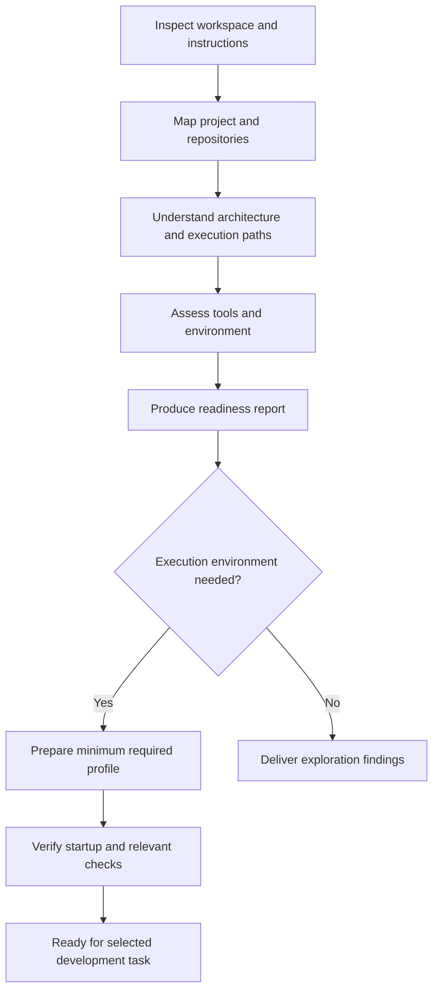

# Project exploration and environment readiness

Status: **proposed topology and procedures**. Existing AOK capabilities are identified
separately below. Inspected baseline: `c2cbc3e4f29bb08b1c2064a411f6e8cc24a015c5`,
on 2026-10-15. Saving this design does not install skills, tools or project dependencies.

Project exploration answers what the project is, how its repositories work, what the
agent can currently do and what is needed to build and verify a selected change.
Environment readiness turns those findings into an appropriately verified execution profile.
A project can be fully explored while its implementation environment remains blocked.

## Position in the workflow topology

| Workflow group | Workflow types |
|---|---|
| Exploration and readiness | Explore project, explore repository, investigate subsystem, assess environment, prepare environment |
| Definition and planning | Research, write specification, make architecture decision, break down work |
| Implementation | Implement feature, fix bug, refactor code, migrate code |
| Review and remediation | Review change, fix review comments |
| Documentation | Generate service docs, update architecture docs, reconcile stale docs |
| Delivery and operations | Prepare PR, fix CI, release, investigate incident |

This is a proposed user-facing entry topology. It groups the more detailed
[12-group catalog](catalog.md); it does not replace its stable research IDs or add new
work-item types. Research, specification, task breakdown, execution and verification can
also be shared activities inside another workflow. Apply the common sequence in proportion
to the task:

```text
Understand → Specify → Break down → Execute → Verify → Deliver
```

The exploration/readiness entry spans the existing proposed catalog groups `discovery`
and `readiness`. Its five entry types map as follows:

| Entry type | Catalog types to reuse | Boundary |
|---|---|---|
| Explore project | `repository-onboarding`, `consumer-mapping`, `technical-research` | Establish product, repositories, owners and cross-repository contracts |
| Explore repository | `repository-onboarding`, `execution-path-tracing` | Explain one repository's structure and development surface |
| Investigate subsystem | `execution-path-tracing`, `consumer-mapping` | Trace only the relevant component and its dependencies |
| Assess environment | `environment-bootstrap`, `validation-setup`, `observability-enablement` | Inspect prerequisites and current capabilities before running setup |
| Prepare environment | `environment-bootstrap`, `agent-instructions`, `validation-setup`, `observability-enablement` | Make necessary authorized changes, then demonstrate readiness |

These entry labels and task decompositions are design refinements, not additional records
in `catalog.json`. Its 12 groups, 48 types and 144 activity entries remain unchanged.

## Sequence and scope



Start with existing file/search/Git capabilities. Findings determine additional setup;
do not require the full development environment just to discover its requirements.
For a multi-repository project, create the project map first, explore relevant repositories,
and explicitly record shared contracts and deployment dependencies. Avoid exhaustive
whole-organization discovery when only one subsystem matters.

## Exploration task breakdown

The task IDs below are local design references, not current AOK task-packet fields.

| ID | Task | Activities | Output and acceptance |
|---|---|---|---|
| E01 | Inspect workspace | Identify roots, checkout, branch, changes, worktrees and applicable instructions | Boundaries and existing user changes recorded; exploration does not alter them |
| E02 | Identify project | Establish product purpose, users, services, repositories and owners | Project overview distinguishes verified relationships from assumptions |
| E03 | Inventory technology | Inspect manifests, lockfiles, runtime declarations, build configuration and generated code | Technology inventory cites actual declaration files and records version conflicts |
| E04 | Map architecture | Locate components, responsibilities, interfaces, storage and external dependencies | Architecture map links important claims to source; unknowns remain explicit |
| E05 | Trace execution | Follow startup and a representative request/job, including relevant errors and shutdown | Concrete entrypoints and data/control flow; observed runtime evidence only when executed |
| E06 | Map development commands | Locate install, build, lint, typecheck, test, run and migration commands | Command matrix includes working directory, prerequisites and expected result |
| E07 | Assess verification | Inspect test layers, fixtures, integration dependencies, UI scenarios and CI | Verification map distinguishes configured checks from checks actually run |
| E08 | Assess agent setup | Inspect instructions, skill/tool availability and integrations | Available, missing and task-conditional capabilities identified without assuming installation |
| E09 | Assess environment | Identify runtimes, services, configuration names, ports, storage and resources | Requirements and blockers recorded without exposing secret values |
| E10 | Produce handoff | Consolidate findings, evidence, assumptions and next useful steps | Next task can begin without repeating material discovery; reuse existing canonical docs |

A static execution trace can satisfy a read-only architecture task if labeled as static.
Do not claim startup, tests or end-to-end behavior passed merely because commands exist.
Missing access to another repository or external service is a scoped limitation, not a
reason to invent relationships or abandon independent local discovery.

## Skills and existing capabilities

| Skill or helper | Status at baseline | Responsibility |
|---|---|---|
| `project-exploration` | Proposed; no skill installed by this design | Own E01–E10 discovery, scope control and source-backed handoff |
| `environment-readiness` | Proposed; no skill installed by this design | Assess/select profiles, coordinate required setup and verify readiness |
| [project-bootstrap](../../../skills/project-bootstrap/SKILL.md) | Existing repository skill content | Initialize AOK operating files, preserve existing instructions and validate setup |
| [agent-workflow](../../../skills/agent-workflow/SKILL.md) | Existing repository skill content | Bounded assignments, roles, evidence, handoffs and escalation |
| [qa-verification](../../../skills/qa-verification/SKILL.md) | Existing repository skill content | Check acceptance against direct evidence |
| [code-review](../../../skills/code-review/SKILL.md) | Existing repository skill content | Review actual changes when setup or later implementation warrants review |
| [Project initialization](../../project-init-guide.md) | Existing CLI/documented generation | Install AOK instructions, templates and Codex local-environment files |
| [Codex local-environment helpers](../../codex-local-environments.md) | Existing templates and CLI/documented generation | Setup diagnostics and common AOK actions |
| Profile selection, readiness result and exploration artifacts | Proposed conventions | No corresponding readiness schema, command or automatic installer claimed |

Existing skill files are reusable content, not evidence that they are enabled in every
agent session. Assess the actual target's discovery/configuration before marking a skill
available. Do not create one new skill for each exploration task; keep detailed procedures
in references owned by the two proposed skills and reuse existing bootstrap/QA content.

### AOK bootstrap and application bootstrap

AOK initialization and application readiness are different responsibilities.
The existing [setup script](../../../templates/.codex/setup.sh) resolves AOK, writes a
report and attempts doctor/project validation. It does not install the application's
runtimes, dependencies, database or fixtures. It tolerates diagnostic failures with
`|| true`, and a missing AOK CLI produces a needs-attention report with exit code zero.
Its successful exit therefore does not establish application readiness.

Existing [action dispatch](../../../templates/.codex/aok-action.sh) exposes doctor,
validation, bundle rendering and other AOK actions. An action being listed is not proof
that the target application's tests or integration services can run. Dedicated application
setup remains a proposed responsibility of `environment-readiness`.

## Tool requirements

| Capability | Minimum or existing tool to inspect | Conditional addition |
|---|---|---|
| Read and search files | File reader, directory listing, `rg` or equivalent | Syntax-aware navigation/LSP when useful |
| Inspect history and workspace | Git inspection | GitHub/GitLab/Azure CLI or connector for authorized remote evidence |
| Inspect configuration | JSON/TOML/YAML readers | Relevant schema validators |
| Run project commands | Shell and repository-declared runtime | Package manager, compiler and build system required by the task |
| Inspect application behavior | Existing logs, HTTP client | Browser automation for UI scenarios |
| Start supporting services | Existing local service mechanisms | Containers, Compose or emulators if the project requires them |
| Research external contracts | Official documentation access | Relevant source/issue/API connector where needed |
| Verify changes | Repository's own checks | Contract, accessibility, performance or security tools justified by scope |

File access, search and Git normally suffice to begin. A Goal, MCP server, cloud account,
container platform or orchestration runtime is not a universal prerequisite. Install only
what the selected task/profile needs. Check actual versions and declared compatibility
rather than treating a binary on PATH as ready. Inspect unfamiliar setup scripts before
execution; run commands within the user's existing authorization and project policy.

## Proposed environment profiles

Readiness is relative to a selected task and profile. These profiles are proposals,
not current `sandbox_mode` values or installed AOK environment selectors. Higher profiles
compose the capabilities they need; every task does not require every profile.

| Profile | Required capabilities | Suitable work | Evidence to call it ready |
|---|---|---|---|
| Inspection | Read relevant files, search and Git inspection | Architecture exploration, research, initial review | Relevant roots/instructions accessible; source references and known gaps recorded |
| Local development | Required runtime, dependencies, build and relevant unit checks | Focused implementation, bug repair, refactoring | Declared versions usable; targeted build/check results observed |
| Service integration | Local development plus required services and fixtures | Database, queue, service integration | Services reachable in the intended test configuration; relevant integration checks observed |
| Application verification | Running application, API/browser tooling and test identities as needed | User journeys and UI/API acceptance | Required interactions exercised; relevant logs/screenshots/traces recorded |
| Delivery | Required CI, artifacts and authorized remote capabilities | PR publication, release, deployment | Delivery prerequisites checked for the actual revision and target; authority remains explicit |

For each profile capture OS/runtime versions, package manager/lockfile, setup and verification
commands, service/startup order, configuration variable names and supply mechanism, ports,
storage, fixtures, cleanup, network/access prerequisites, expected results and blockers.
Use isolated development inputs where appropriate. Never copy credentials into reports.
A delivery-ready environment does not by itself authorize publication, merge or deployment.

## Environment preparation tasks

| ID | Task | Result |
|---|---|---|
| R01 | Select the minimum profile for the next task | Scope and required capabilities are explicit |
| R02 | Check installed tools against repository declarations | Version compatibility and missing tools identified |
| R03 | Prepare the workspace | Existing changes preserved; isolation chosen for actual needs |
| R04 | Install necessary dependencies through documented mechanisms | Lockfile/package-manager intent respected; setup changes recorded |
| R05 | Supply local configuration and start necessary services | Task-specific dependencies available without leaked secrets |
| R06 | Run smoke, build and relevant verification | Actual results and environmental/product failures distinguished |
| R07 | Record readiness, blockers and cleanup | Reproducible handoff bound to revision/environment |

A failed setup does not require discarding successful exploration. Record the blocked
capability, the task it prevents, evidence and the input/change needed. Do not repeatedly
rerun failed setup without a new hypothesis. External prerequisites and unrelated failing
tests should not be silently marked passed.

## Outputs and ownership

| Logical output | Contents | Suggested convention |
|---|---|---|
| Project map | Purpose, repositories, components, owners, important execution paths | Reuse architecture docs; create a project map only if missing |
| Development guide | Setup, run, build, test and troubleshooting commands | Reuse README/CONTRIBUTING/development docs |
| Readiness report | Profile, prerequisites, executed checks, observations and blockers | A task-linked report; no mandatory path or installed schema |
| Task handoff | Relevant scope, files, constraints, verification and unresolved matters | Existing task `spec` and verification fields or linked document |

Do not insert new readiness/skill/profile fields into current packets: the task schema
rejects unknown properties. Proposed artifact names and task IDs are design conventions.
Do not create competing sources of truth when existing documentation already owns the facts.

Each material claim should be classified as **observed**, **documented but untested**,
**inferred**, or **unknown**. Each relevant capability/check should have an outcome such as
**ready/pass**, **failed**, **blocked**, **not checked**, or **not applicable with rationale**.
These are report vocabulary proposals, not new neutral task statuses. An unknown or
unexecuted required check cannot satisfy the selected readiness profile.

## Acceptance criteria

### Exploration complete

- Applicable instructions, workspace boundaries and existing changes are identified.
- Product/project/repository relationships and relevant owners are mapped with provenance.
- Relevant architecture and execution paths are explained with source references.
- Development commands include working directory, prerequisites and expected outcomes.
- Tools/skills are distinguished as available, missing or task-conditional.
- Environmental requirements and verification gaps are explicit.
- Observed results are separated from documented procedures, inference and unknowns.
- The handoff supports the next scoped task without repeating basic discovery.
- No unrelated source, configuration or external resource was changed by discovery.

### Selected environment profile ready

- Required tool/runtime versions and dependencies are usable for the selected task.
- Necessary services, fixtures and configuration inputs are available.
- Required smoke/build/verification checks have actual recorded outcomes at the relevant revision.
- Required failed, blocked or unchecked capabilities prevent a ready verdict; optional gaps
  are recorded without overstating their impact.
- Setup steps and remaining limitations are reproducible from the guide/report.
- User changes are preserved, secrets are excluded and cleanup/recovery is documented.
- Tool access and readiness do not expand the user's authorization.

The exploration outcome and environment outcome are reported separately. Neither a completed
report nor a successful AOK helper exit substitutes for observed application checks.

## Implementation relationship

Implement the `project-exploration` content first, then `environment-readiness`, sharing
existing bootstrap and QA responsibilities. Phase 1 can deliver procedures and templates;
phase 2 can add validated readiness records if needed. Phase 3 maps target-specific tools
and setup actions; phase 4 handles external runtime execution where warranted. See the
[phased plan](implementation-plan.md). No such skill or runtime integration is implemented
by this document.
