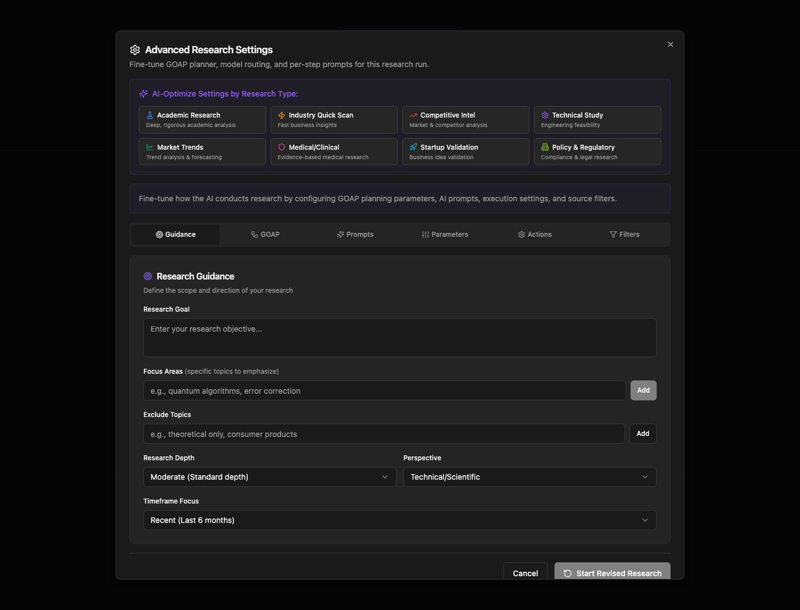
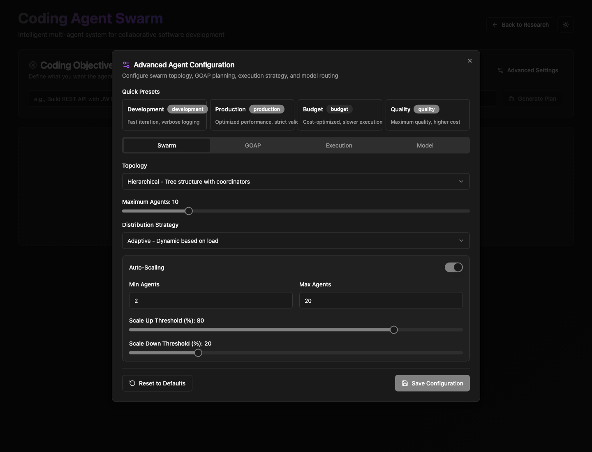

# Goal ruv io screenshot evidence

These are real live-site Chrome screenshots, captured in an isolated profile. Use settled screenshots 61–70 for default-field review. Each matching browser `.txt` file contains an accessibility snapshot; initial tab captures also have `.fields.json` inventories. Backend failures are shown as failures, not successful optimization.

## Both controls

## Screenshot inventory

| Screenshot | State |
|---|---|
| [01-research-home.png](evidence/screenshots/01-research-home.png) | 01 research home |
| [02-research-open.png](evidence/screenshots/02-research-open.png) | 02 research open |
| [03-research-default-guidance.png](evidence/screenshots/03-research-default-guidance.png) | 03 research default guidance |
| [04-research-default-goap.png](evidence/screenshots/04-research-default-goap.png) | 04 research default goap |
| [05-research-default-prompts.png](evidence/screenshots/05-research-default-prompts.png) | 05 research default prompts |
| [06-research-default-parameters.png](evidence/screenshots/06-research-default-parameters.png) | 06 research default parameters |
| [07-research-default-actions.png](evidence/screenshots/07-research-default-actions.png) | 07 research default actions |
| [08-research-default-filters.png](evidence/screenshots/08-research-default-filters.png) | 08 research default filters |
| [09-research-preset-academic-research.png](evidence/screenshots/09-research-preset-academic-research.png) | 09 research preset academic research |
| [10-research-preset-industry-quick-scan.png](evidence/screenshots/10-research-preset-industry-quick-scan.png) | 10 research preset industry quick scan |
| [11-research-preset-competitive-intel.png](evidence/screenshots/11-research-preset-competitive-intel.png) | 11 research preset competitive intel |
| [12-research-preset-technical-study.png](evidence/screenshots/12-research-preset-technical-study.png) | 12 research preset technical study |
| [13-research-preset-market-trends.png](evidence/screenshots/13-research-preset-market-trends.png) | 13 research preset market trends |
| [14-research-preset-medical-clinical.png](evidence/screenshots/14-research-preset-medical-clinical.png) | 14 research preset medical clinical |
| [15-research-preset-startup-validation.png](evidence/screenshots/15-research-preset-startup-validation.png) | 15 research preset startup validation |
| [16-research-preset-policy-regulatory.png](evidence/screenshots/16-research-preset-policy-regulatory.png) | 16 research preset policy regulatory |
| [17-research-applied.png](evidence/screenshots/17-research-applied.png) | 17 research applied |
| [18-research-reload-defaults.png](evidence/screenshots/18-research-reload-defaults.png) | 18 research reload defaults |
| [19-agents-home.png](evidence/screenshots/19-agents-home.png) | 19 agents home |
| [20-agents-open.png](evidence/screenshots/20-agents-open.png) | 20 agents open |
| [21-agents-default-swarm.png](evidence/screenshots/21-agents-default-swarm.png) | 21 agents default swarm |
| [22-agents-default-goap.png](evidence/screenshots/22-agents-default-goap.png) | 22 agents default goap |
| [23-agents-default-execution.png](evidence/screenshots/23-agents-default-execution.png) | 23 agents default execution |
| [24-agents-default-model.png](evidence/screenshots/24-agents-default-model.png) | 24 agents default model |
| [25-agents-autoscaling-off.png](evidence/screenshots/25-agents-autoscaling-off.png) | 25 agents autoscaling off |
| [26-agents-preset-development.png](evidence/screenshots/26-agents-preset-development.png) | 26 agents preset development |
| [27-agents-preset-production.png](evidence/screenshots/27-agents-preset-production.png) | 27 agents preset production |
| [28-agents-preset-budget.png](evidence/screenshots/28-agents-preset-budget.png) | 28 agents preset budget |
| [29-agents-preset-quality.png](evidence/screenshots/29-agents-preset-quality.png) | 29 agents preset quality |
| [30-agents-unsaved-reopen.png](evidence/screenshots/30-agents-unsaved-reopen.png) | 30 agents unsaved reopen |
| [31-agents-finished.png](evidence/screenshots/31-agents-finished.png) | 31 agents finished |
| [41-research-manual-guidance.png](evidence/screenshots/41-research-manual-guidance.png) | 41 research manual guidance |
| [42-research-manual-parameters.png](evidence/screenshots/42-research-manual-parameters.png) | 42 research manual parameters |
| [43-research-manual-filters.png](evidence/screenshots/43-research-manual-filters.png) | 43 research manual filters |
| [44-research-applied-settled.png](evidence/screenshots/44-research-applied-settled.png) | 44 research applied settled |
| [45-research-autostart.png](evidence/screenshots/45-research-autostart.png) | 45 research autostart |
| [46-research-mid-execution.png](evidence/screenshots/46-research-mid-execution.png) | 46 research mid execution |
| [47-research-final.png](evidence/screenshots/47-research-final.png) | 47 research final |
| [48-agents-inverted-range.png](evidence/screenshots/48-agents-inverted-range.png) | 48 agents inverted range |
| [49-agents-dijkstra-custom.png](evidence/screenshots/49-agents-dijkstra-custom.png) | 49 agents dijkstra custom |
| [61-research-settled-guidance-bottom.png](evidence/screenshots/61-research-settled-guidance-bottom.png) | 61 research settled guidance bottom |
| [61-research-settled-guidance.png](evidence/screenshots/61-research-settled-guidance.png) | 61 research settled guidance |
| [62-research-settled-goap-bottom.png](evidence/screenshots/62-research-settled-goap-bottom.png) | 62 research settled goap bottom |
| [62-research-settled-goap.png](evidence/screenshots/62-research-settled-goap.png) | 62 research settled goap |
| [63-research-settled-prompts-bottom.png](evidence/screenshots/63-research-settled-prompts-bottom.png) | 63 research settled prompts bottom |
| [63-research-settled-prompts.png](evidence/screenshots/63-research-settled-prompts.png) | 63 research settled prompts |
| [64-research-settled-parameters.png](evidence/screenshots/64-research-settled-parameters.png) | 64 research settled parameters |
| [65-research-settled-actions.png](evidence/screenshots/65-research-settled-actions.png) | 65 research settled actions |
| [66-research-settled-filters-bottom.png](evidence/screenshots/66-research-settled-filters-bottom.png) | 66 research settled filters bottom |
| [66-research-settled-filters.png](evidence/screenshots/66-research-settled-filters.png) | 66 research settled filters |
| [67-agents-settled-swarm.png](evidence/screenshots/67-agents-settled-swarm.png) | 67 agents settled swarm |
| [68-agents-settled-goap.png](evidence/screenshots/68-agents-settled-goap.png) | 68 agents settled goap |
| [69-agents-settled-execution.png](evidence/screenshots/69-agents-settled-execution.png) | 69 agents settled execution |
| [70-agents-settled-model.png](evidence/screenshots/70-agents-settled-model.png) | 70 agents settled model |
| [attempt1-47-research-partial.png](evidence/screenshots/attempt1-47-research-partial.png) | attempt1 47 research partial |
