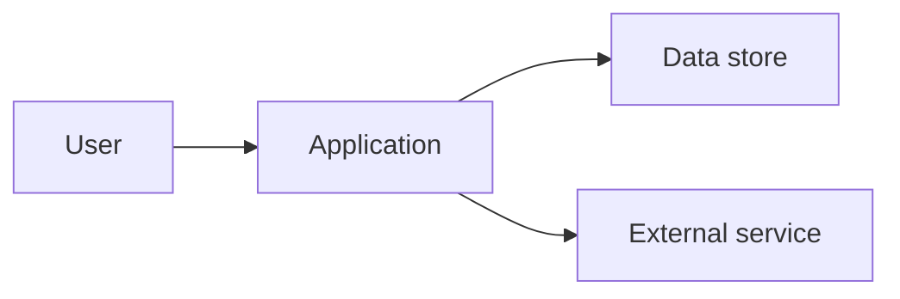

# Architecture Model

## Architecture Drivers

| Driver | Source requirement or risk | Architectural response | Evidence |
|---|---|---|---|
| | | | |

## Structure and Deployment View

- Component responsibilities:
- Runtime boundaries:
- Data ownership:

## Just-Enough Domain Model

- Key concepts and relationships:
- UML, ER, or other model link:
- Model assumptions:

## Decisions

| Decision | Context | Choice | Consequence | Evidence |
|---|---|---|---|---|
| | | | | |

## Architecture Risk Evidence

| Risk | Spike or working-skeleton test | Result | Residual risk |
|---|---|---|---|
| | | | |

## Lifecycle Architecture Decision

- Architecture proven sufficiently: Yes / No
- Stakeholder decision:
- Conditions:
