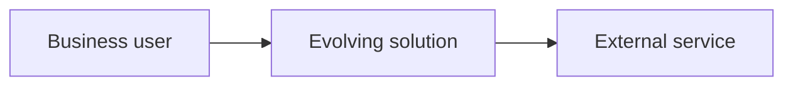

# Solution Architecture Definition

## Business and Process Context

- Business capabilities:
- Process boundaries:
- Users and external actors:

## Technical Architecture

- Components and responsibilities:
- Runtime and deployment topology:
- Data ownership:

## Entities and Integrations

| Entity or integration | Owner | Contract or relationship | Data sensitivity |
|---|---|---|---|
| | | | |

## Non-Functional Requirements

| Area | Requirement | Measure | Evidence |
|---|---|---|---|
| Security | | | |
| Performance | | | |
| Reliability | | | |

## Constraints, Assumptions, and Integrity Risks

| Type | Description | Response | Owner |
|---|---|---|---|
| | | | |

## Evolution Log

| Date | Decision or change | Requirements affected | Approver |
|---|---|---|---|
| | | | |
