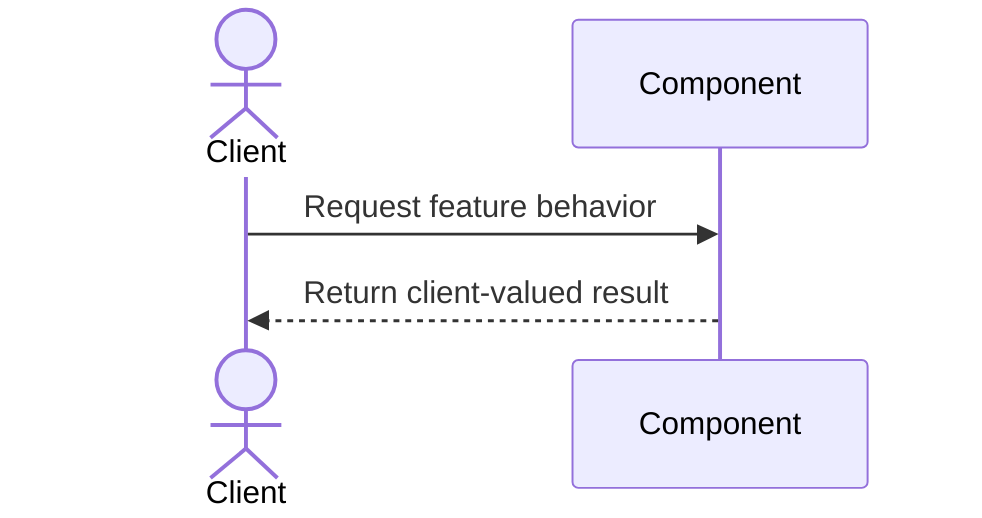

# Feature Design Package

## Feature Identity

- Subject Area:
- Business Activity:
- Feature ID:
- Feature Name:
- Chief Programmer:
- Feature Team:

## Sequence Diagram

## Class and Component Interactions

| Class / Component | Owner | Responsibility | Interaction |
|---|---|---|---|
| | | | |

## Interface Specifications

| Interface | Inputs | Outputs | Errors / Constraints |
|---|---|---|---|
| | | | |

## Affected Classes and Components

-

## Design Decisions

| Decision | Rationale | Alternatives | Consequences |
|---|---|---|---|
| | | | |

## Design Inspection Readiness

- [ ] Domain walkthrough completed
- [ ] Sequence and interactions are documented
- [ ] Class owners participated
- [ ] Open design risks are explicit
