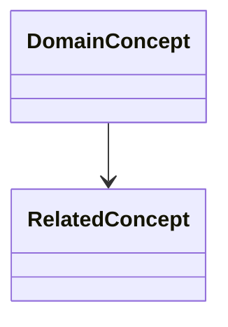
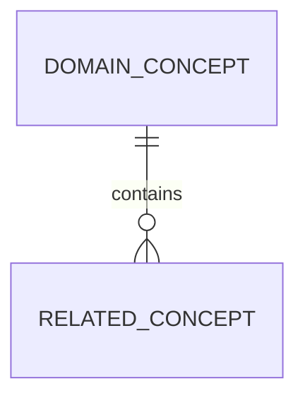

# Overall Domain Model

Use this artifact to record the shared domain shape that anchors the feature list. Link authoritative diagrams when they live in a modeling tool.

## Domain Walkthrough Notes

- Participants:
- Business scope:
- Important workflows:
- Vocabulary and definitions:

## High-Level Class or Domain Model

## Entity Relationship Model

## Subject Areas and Bounded Contexts

| Subject Area | Purpose | Key Concepts | Upstream / Downstream Contexts | Owner |
|---|---|---|---|---|
| | | | | |

## Assumptions

-

## Open Questions

-
